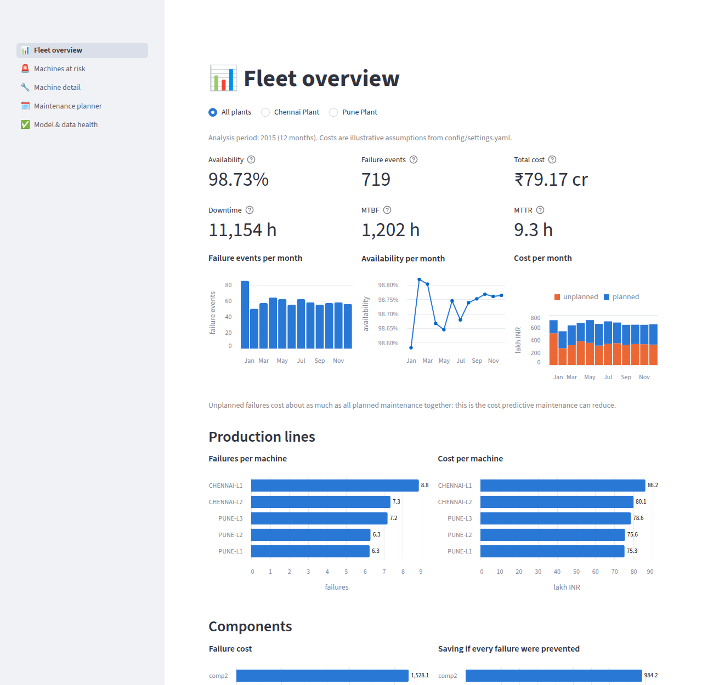
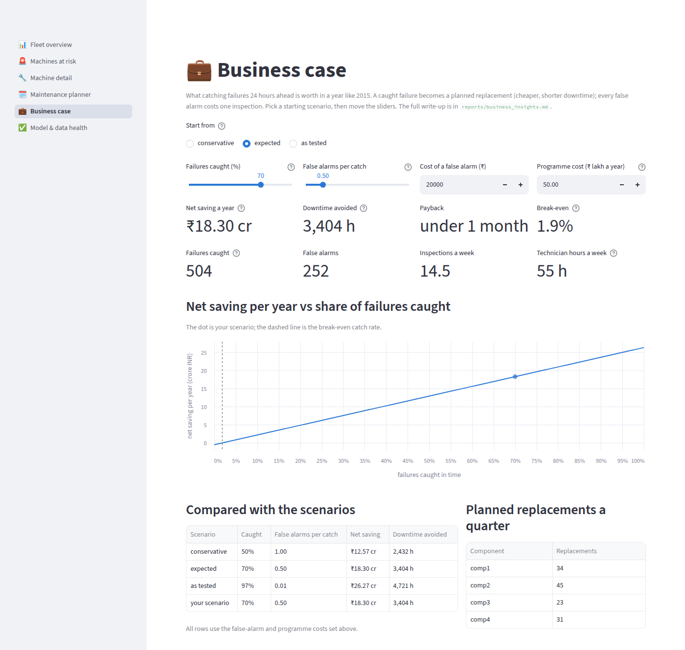

# Industrial IoT Sensor Analytics Platform

End-to-end **Data Engineering + Machine Learning** platform that turns raw industrial sensor data into **24-hour failure warnings** and **business decisions**, moving a plant from reactive to predictive maintenance.

| 97% | 1 | ₹18.3 cr / year | 1.9% | 459 |
|:---:|:---:|:---:|:---:|:---:|
| failures caught 24 h ahead (test months) | false alarm on the test months | expected net saving (70% caught) | break-even catch rate | automated tests |



---

## 📌 Problem

Plants fix machines **after** they break: unplanned downtime, emergency repairs, and sensor data that is too messy to trust. This project builds the full path from raw sensor readings to *"replace comp2 on machine 42 now, it will save ₹3.8 lakh"*.

## 🏗️ Architecture

```
 SENSOR DATA ─► BRONZE ─────► SILVER ──────► GOLD ─────────► DATA MODEL ───► DASHBOARD
 telemetry,     raw Parquet   cleaned,       features,       DuckDB star     Streamlit,
 errors,        + lineage,    validated,     labels, KPIs,   schema + views  6 pages
 maintenance,   idempotent    quality flags  ML dataset           ▲              │
 failures                                         │               │              ▼
                                                  └──► MACHINE LEARNING ──► BUSINESS INSIGHTS
                                                       failure 24 h,         scenarios, payback,
                                                       component, anomaly    where to focus
                                                       (tracked in MLflow)

 Every layer ends with automated quality checks · one command runs it all: `iiot run`
```

| Layer | What it does |
|---|---|
| **Bronze** | Raw files → Parquet, unchanged, with lineage columns; SHA-256 makes re-runs skip unchanged files |
| **Silver** | Typing, deduplication, spike and stuck-sensor detection, gap filling, a quality flag per value; *proven* against injected data-quality issues |
| **Gold** | Backward-looking features, forward-looking labels, leakage-safe time split, KPIs (MTBF, MTTR, availability, cost) |
| **Data model** | DuckDB star schema: 5 dimensions, 6 facts (incl. predictions), analytical views |
| **ML** | scikit-learn models, baselines first, business metrics, plain-language alert reasons, MLflow tracking and registry |
| **Dashboard** | Fleet overview, machines at risk, machine detail, maintenance planner, business case (what-if), model & data health |
| **Insights** | Scenarios, break-even, sensitivity, focus areas and a [business report](reports/business_insights.md) |

📖 Design details: [docs/architecture.md](docs/architecture.md)

## 📊 Data

[Microsoft Azure Predictive Maintenance dataset](https://www.kaggle.com/datasets/arnabbiswas1/microsoft-azure-predictive-maintenance) (synthetic): **100 machines, hourly readings for 2015**: 876K sensor rows, 3.9K errors, 3.3K replacements, 761 component failures. Added on top: plants and lines (Pune, Chennai), component costs in INR, and injected data-quality issues (stuck sensors, gaps, spikes, duplicates) to prove the cleaning works.

## 🤖 Machine Learning results (test months Oct–Dec 2015, never seen in training)

| Model | Result | Baseline |
|---|---|---|
| **Failure within 24 h** (gradient boosting) | **166 / 171 failures caught, 1 false alarm**, ₹6.41 cr net saving | error5 rule: 43 / 171, 40 false alarms |
| **Which component** (multi-label) | right component ranked first **100%** | most frequent component: 42% |
| **Anomaly** (Isolation Forest, no labels) | **12× more flags** in the 48 h before a failure | — |

Time-based split, thresholds chosen on business value (net saving), leakage checked four ways. Synthetic data has strong patterns, so real-plant scores would be lower.

## 💡 Business insights

| Scenario | Failures caught | Net saving / year | Downtime avoided | Payback |
|---|---|---|---|---|
| Conservative | 50% | ₹12.57 cr | 2,432 h | < 1 month |
| **Expected** | **70%** | **₹18.30 cr** | **3,404 h** | **< 1 month** |
| As tested | 97% | ₹26.27 cr | 4,721 h | < 1 month |

**Focus first on** CHENNAI-L1 (25% of failure cost), machines aged 15+ years (9.0 failures a year vs 5.5 under 10 years) and model1. Full report: **[reports/business_insights.md](reports/business_insights.md)**.



## 🛠️ Tech stack

Python 3.11 · pandas · Parquet (PyArrow) · DuckDB · scikit-learn · MLflow · Streamlit + Altair · pytest · ruff

## 🚀 Quick start

```bash
git clone https://github.com/OmPatil2806/Industrial-IoT-Sensor-Analytics-Platform-.git
cd Industrial-IoT-Sensor-Analytics-Platform-
python -m venv .venv
.venv\Scripts\Activate.ps1            # macOS/Linux: source .venv/bin/activate
pip install -r requirements-dev.txt
pip install -e .

iiot run          # full pipeline: data → Bronze → Silver → Gold → warehouse → ML → insights (~5 min)
iiot dashboard    # http://localhost:8501
pytest            # 459 tests
```

| Command | Purpose |
|---|---|
| `iiot run --skip-ml` | Data pipeline only (~35 s) |
| `iiot <layer> build / report` | One layer: `bronze`, `silver`, `gold`, `model` |
| `iiot ml train / score / report` | Train, score and check the models |
| `iiot insights build / report` | Business case and report |
| `mlflow ui --backend-store-uri sqlite:///mlruns/mlflow.db --workers 1` | Experiment tracking UI (http://127.0.0.1:5000) |

Settings (paths, sensor limits, costs, ML) live in [`config/settings.yaml`](config/settings.yaml). Notebooks for EDA, the warehouse and ML results are in [`notebooks/`](notebooks/).

---

## 👤 Author

**Om Patil**: [GitHub @OmPatil2806](https://github.com/OmPatil2806)
