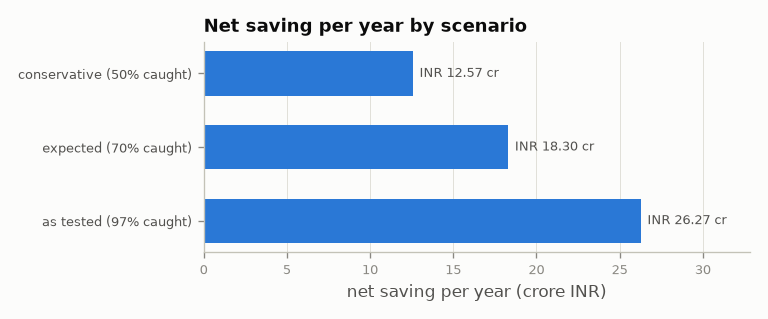
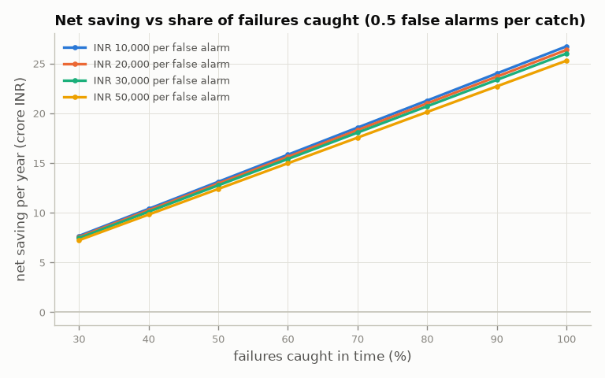
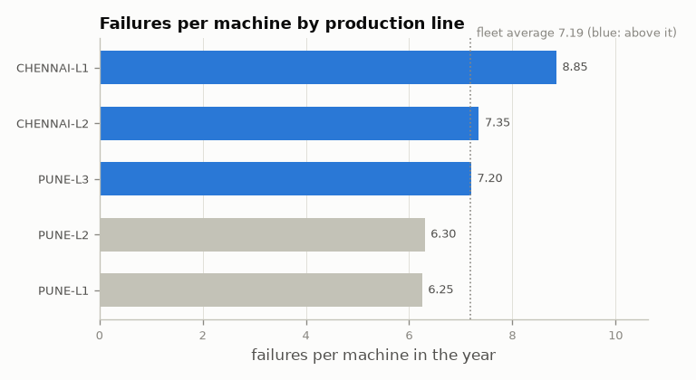
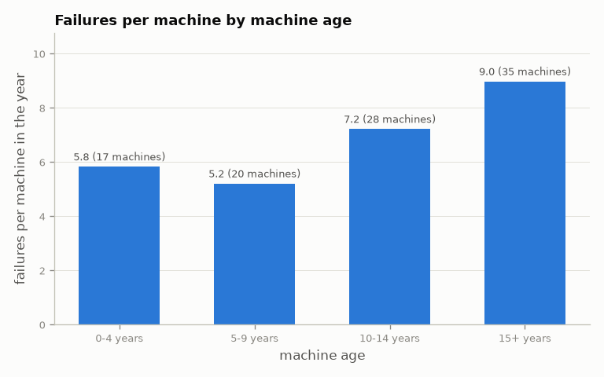
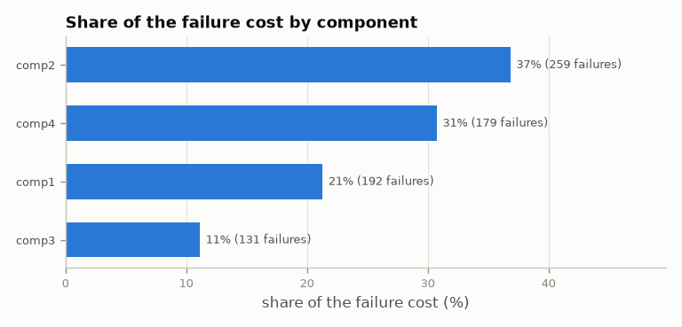

# Industrial IoT Sensor Analytics: business insights

_Generated 2026-10-11 from `reports/insights.json` (`iiot.insights`). All amounts in INR; 1 cr = 1 crore = ₹1,00,00,000._

## Executive summary

In the year analysed, the fleet of 100 machines had **719 unplanned failures** costing **₹41.48 cr** and **11,154 hours** of downtime. Predicting failures 24 hours ahead turns most of them into planned replacements, which are cheaper and faster.

| Key number | Value |
|---|---|
| Unplanned failure cost today | ₹41.48 cr a year |
| Net saving, expected case (70% caught) | **₹18.30 cr a year** |
| Downtime avoided, expected case | 3,404 h a year (+0.39 pts availability) |
| Payback of the programme | under 1 month |
| Break-even: share of failures to catch | 1.9% |

**Recommendations**

1. **Roll out the 24-hour failure alerts.** Even the conservative case (50% caught, 1 false alarm per catch) saves ₹12.57 cr a year; the programme pays for itself once it catches 1.9% of failures.
2. **Start with CHENNAI-L1** (Chennai Plant): 8.85 failures per machine and 25% of the failure cost. 3 lines are above the fleet average: CHENNAI-L1, CHENNAI-L2, PUNE-L3.
3. **Prioritise older machines and model1.** Machines aged 15+ years fail 9.0 times a year, against 5.5 for machines under 10 years; model1 fails 10.9 times per machine against 5.4 for model4. Review them for overhaul or replacement.
4. **Plan spare parts by quarter.** In the expected case about 34 comp1, 45 comp2, 23 comp3, 31 comp4 replacements a quarter; comp2 alone is 37% of the failure cost.
5. **Put the warning signs into inspection checklists** (see [Warning signatures](#warning-signatures)): each component fails with its own recognisable pattern.

## Today: what failures cost

| Measure | Value |
|---|---|
| Machines | 100 |
| Unplanned failures | 719 |
| Component failures | comp1 192, comp2 259, comp3 131, comp4 179 |
| Downtime | 11,154 h |
| Fleet availability | 98.73% |
| Mean time between failures | 1,202 h |
| Mean time to repair | 9.3 h |
| Failure cost | ₹41.48 cr |
| Planned maintenance cost | ₹37.69 cr |
| Saving if every failure were caught in time | ₹27.58 cr |

## Business case

Each scenario sets the share of failures caught 24 hours ahead and how many false alarms come with each catch. A caught failure becomes a planned replacement; each false alarm costs one inspection (₹20,000); the programme costs ₹50.0 lakh a year. "As tested" uses what the model actually achieved on the test months it never saw.

| Per year | conservative | expected | as tested |
|---|---|---|---|
| Failures caught | 50% | 70% | 97% |
| False alarms per catch | 1.00 | 0.50 | 0.01 |
| Failures caught (count) | 360 | 504 | 698 |
| Gross saving | ₹13.79 cr | ₹19.31 cr | ₹26.77 cr |
| False-alarm cost | ₹71.9 lakh | ₹50.4 lakh | ₹84,151 |
| Programme cost | ₹50.0 lakh | ₹50.0 lakh | ₹50.0 lakh |
| **Net saving** | **₹12.57 cr** | **₹18.30 cr** | **₹26.27 cr** |
| Downtime avoided | 2,432 h | 3,404 h | 4,721 h |
| Availability gain | +0.28 pts | +0.39 pts | +0.54 pts |
| Payback | under 1 month | under 1 month | under 1 month |

### How sure is the saving?

Net saving for other catch rates and inspection costs (0.5 false alarms per catch). It stays positive across the whole range: the result does not hinge on the model being as good as it tested.

| Caught | ₹10,000 / false alarm | ₹20,000 / false alarm | ₹30,000 / false alarm | ₹50,000 / false alarm |
|---|---|---|---|---|
| 30% | ₹7.67 cr | ₹7.56 cr | ₹7.45 cr | ₹7.23 cr |
| 40% | ₹10.39 cr | ₹10.24 cr | ₹10.10 cr | ₹9.81 cr |
| 50% | ₹13.11 cr | ₹12.93 cr | ₹12.75 cr | ₹12.39 cr |
| 60% | ₹15.83 cr | ₹15.62 cr | ₹15.40 cr | ₹14.97 cr |
| 70% | ₹18.55 cr | ₹18.30 cr | ₹18.05 cr | ₹17.55 cr |
| 80% | ₹21.28 cr | ₹20.99 cr | ₹20.70 cr | ₹20.13 cr |
| 90% | ₹24.00 cr | ₹23.67 cr | ₹23.35 cr | ₹22.70 cr |
| 100% | ₹26.72 cr | ₹26.36 cr | ₹26.00 cr | ₹25.28 cr |

## Where to focus

### Production lines

| Line | Plant | Failures per machine | Share of failure cost | Availability |
|---|---|---|---|---|
| **CHENNAI-L1** | Chennai Plant | 8.85 | 24.9% | 98.58% |
| **CHENNAI-L2** | Chennai Plant | 7.35 | 20.6% | 98.70% |
| **PUNE-L3** | Pune Plant | 7.20 | 19.6% | 98.75% |
| PUNE-L2 | Pune Plant | 6.30 | 17.1% | 98.80% |
| PUNE-L1 | Pune Plant | 6.25 | 17.8% | 98.80% |

Lines in bold are above the fleet average.

### Machine age and model

| Model | Machines | Failures per machine | Cost per machine |
|---|---|---|---|
| model1 | 16 | 10.9 | ₹91.4 lakh |
| model2 | 17 | 9.4 | ₹84.2 lakh |
| model3 | 35 | 6.1 | ₹77.4 lakh |
| model4 | 32 | 5.4 | ₹72.3 lakh |

### Costliest machines

The 10 costliest machines cause 18.5% of the failure cost (an even spread would be 10%).

| Machine | Model | Age | Line | Failures | Total cost |
|---|---|---|---|---|---|
| 99 | model1 | 14 | CHENNAI-L1 | 19 | ₹1.22 cr |
| 83 | model4 | 18 | CHENNAI-L1 | 12 | ₹1.14 cr |
| 98 | model2 | 20 | PUNE-L1 | 14 | ₹1.14 cr |
| 37 | model1 | 16 | CHENNAI-L2 | 14 | ₹1.09 cr |
| 17 | model1 | 14 | CHENNAI-L1 | 13 | ₹1.06 cr |
| 22 | model1 | 14 | PUNE-L1 | 13 | ₹1.03 cr |
| 7 | model3 | 20 | CHENNAI-L2 | 9 | ₹99.5 lakh |
| 13 | model1 | 15 | CHENNAI-L2 | 10 | ₹98.7 lakh |
| 20 | model2 | 16 | CHENNAI-L2 | 13 | ₹98.6 lakh |
| 35 | model1 | 17 | CHENNAI-L1 | 10 | ₹98.1 lakh |

### Components

| Component | Failures | Cost per failure | Share of failure cost | Share of possible saving |
|---|---|---|---|---|
| comp2 | 259 | ₹5.9 lakh | 36.8% | 35.7% |
| comp4 | 179 | ₹7.1 lakh | 30.7% | 31.7% |
| comp1 | 192 | ₹4.6 lakh | 21.3% | 22.3% |
| comp3 | 131 | ₹3.5 lakh | 11.1% | 10.3% |

## Warning signatures

The inputs most often named in the reasons for out-of-sample alerts, per predicted component. Technicians can check these first.

| Component | Warning signs (share of its alerts) |
|---|---|
| comp1 | error1 (93%); voltage (90%) |
| comp2 | rotation (92%); error3 (42%) |
| comp3 | error4 (97%); pressure (97%) |
| comp4 | error5 (96%); vibration (96%) |

## What it means for operations (expected case)

| Measure | Value |
|---|---|
| Inspections per week | 14.5 |
| Technician hours per week (inspections + planned replacements) | 55 h |
| Planned replacements per quarter | comp1 34, comp2 45, comp3 23, comp4 31 |

## Next steps: a 3-month pilot

1. **Scope:** the lines above the fleet average (CHENNAI-L1, CHENNAI-L2, PUNE-L3), starting with CHENNAI-L1.
2. **Run:** send the 24-hour alerts and their reasons to the line's maintenance team every shift; log each inspection as a catch or a false alarm.
3. **Go / no-go:** continue to all lines if the pilot catches at least 50% of failures with no more than 1 false alarm per catch (the conservative case, which already pays back).
4. **Keep the model honest:** retrain when the data drifts (`iiot run` checks the data fingerprint) and track every run in MLflow.

## Assumptions and limits

- Costs per component come from `config/settings.yaml` (parts, labour and ₹50,000 per hour of downtime); a false alarm costs ₹20,000 and 2 technician hours; the programme costs ₹50.0 lakh a year.
- A failure event is all components of one machine failing at one time; its downtime is the longest repair, which becomes the longest planned replacement when caught.
- The data are Microsoft's synthetic Azure Predictive Maintenance dataset (one year, 100 machines). Its failures follow strong patterns, so the "as tested" result (97% caught) is better than a real plant would see: plan with the expected case.
- Test period: 166 of 171 failures caught with 1 false alarm.
